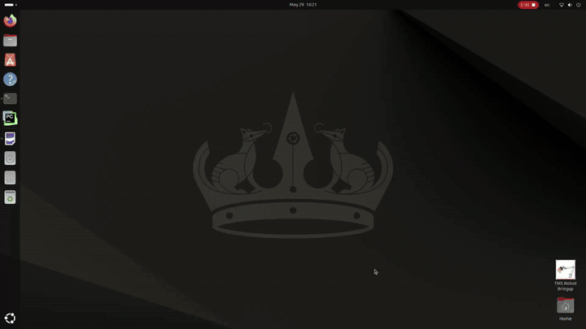

# TMS Robot Workspace

ROS 2 Jazzy workspace for a robot-assisted Transcranial Magnetic Stimulation (TMS) system. A UR10e arm carries the TMS coil to a target pose on the head. A Robotiq FT-300S force torque sensor keeps contact force in a set band during treatment. A behaviour tree runs the session, and a Qt control panel shows the camera view, RViz, and the tree state.



The GIF plays the demo at 8x speed. The full 3 min 23 s recording is in [docs/media/tms_robot.mp4](docs/media/tms_robot.mp4).

The demo shows one session in order:

1. Launch of the UI and the robot software.
2. Move to the "Above Head" pose.
3. Move to the target pose from the camera.
4. Start of contact treatment.
5. Auto holding treatment under force control.
6. Retract after the treatment timer ends.

## Packages

| Package | Purpose |
| --- | --- |
| `tms_robot_bringup` | Launch files, the demo operator node, the TCP pose publisher, and the desktop shortcut |
| `tms_robot_control` | Behaviour tree executor and the tree files in `tree/` |
| `tms_robot_ui` | Qt control panel with embedded RViz, AI camera view, and behaviour tree monitor |
| `tms_robot_description` | Robot cell description |
| `tms_robot_hardware` | UR robot hardware interface and calibration files |
| `tms_robot_moveit_config` | MoveIt configuration for the robot cell |
| `tms_robot_interfaces` | Messages, services, and actions for the system |
| `rq_fts_ros2_driver` | Robotiq force torque sensor driver, ported from the [ROS 1 Robotiq driver](https://github.com/ros-industrial/robotiq) |
| `uc4_adc_driver` | Driver for the UC4 analog to digital converter |

## Build

```bash
cd ~/tms_ws
rosdep install --from-paths src --ignore-src -r -y
colcon build --symlink-install
source install/setup.bash
```

## Run

Hardware setup steps for the serial devices and the desktop shortcut are in [tms_robot_bringup/README.md](src/tms_robot/tms_robot_bringup/README.md).

Full system on real hardware:

```bash
ros2 launch tms_robot_bringup all.launch.py robot_ip:=192.168.0.2
```

Full system with mock hardware:

```bash
ros2 launch tms_robot_bringup all.launch.py use_mock_hardware:=true
```

Single parts of the system start with the `*_only.launch.py` files in `tms_robot_bringup/launch`, for example `fts_only.launch.py` or `ui_only.launch.py`.

The desktop script `run_all_launch.sh` stops any earlier stack before a new start. The script writes one time-stamped log per session to `~/tms_session_logs`.

The camera target pipeline is not part of this repository. `run_all_launch_with_camera.sh` expects the pipeline in `~/Documents/TMS/local_codes/camera_ros2_topic`.

## Helper scripts

The scripts in the workspace root call MoveIt services only and do not move the robot.

- `capture_ready.py` computes a new "ready" pose 0.40 m above the current TCP pose.
- `plan_check.py` plans the `move_arm_ready` legs and prints the TCP distance to the head along the path.
- `retract_check.py` computes the 0.10 m retract path along TCP Z and checks the joint path for configuration jumps.

## Authors

- Koh Keng Huat, Industrial Centre, The Hong Kong Polytechnic University
- Sun Xijun, Industrial Centre, The Hong Kong Polytechnic University

The force torque sensor driver in `rq_fts_ros2_driver` comes from the [ROS 1 Robotiq driver](https://github.com/ros-industrial/robotiq) and its ROS 2 port. The original authors and licenses of that driver are kept.

## Citation

No paper on this project has been published yet. To cite the software, use the "Cite this repository" button on GitHub or the metadata in [CITATION.cff](CITATION.cff):

```bibtex
@software{koh_sun_tms_ws_2026,
  author = {Koh, Keng Huat and Sun, Xijun},
  title  = {{TMS Robot Workspace}},
  year   = {2026},
  url    = {https://github.com/sunxijunjun/tms_ws}
}
```

## License

The workspace is released under the Apache License 2.0 (see [LICENSE](LICENSE) and [NOTICE](NOTICE)). Most packages also carry their own license file. `rq_fts_ros2_driver` uses a BSD license. `tms_robot_moveit_config` declares BSD-3-Clause in its `package.xml`.
